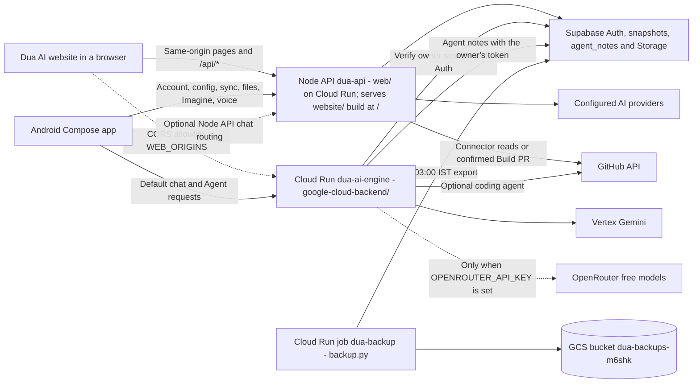

# Dua AI architecture and contributor map

This describes the current implementation, not a proposed redesign. Start with the runtime map, follow one chat request, then use the change/test map below. [README](../README.md#local-setup) covers installation and configuration; [ROADMAP](ROADMAP.md) tracks future improvements.

## Runtime map

Android's [Gradle configuration](../app/build.gradle.kts) sets two independent HTTPS URLs: `DUA_API_BASE_URL` for base services and `DUA_CHAT_BASE_URL` for chat. Chat defaults to Cloud Run. Pointing both to the same Node API backend selects its chat implementation instead; changing only the base URL does not redirect chat. See the [routing overrides](../README.md#android-app). Deployed values and credentials cannot be inferred from the source checkout.

The engine answers with Vertex Gemini (`VERTEX_MODEL`; the Agent loop can use a separate `AGENT_MODEL`). When `OPENROUTER_API_KEY` is set it also lists free OpenRouter models in `GET /` and can answer with them. The Node API's provider picker, Build mode, Run code and completed-reply saving are different capabilities. Engine availability is independent of the Node API's provider API keys. See the [engine README](../google-cloud-backend/README.md#endpoints) for its supported protocol and limitations.

## Directory map

| Location | What belongs here / first files to open |
| --- | --- |
| [`app/`](../app) | The single Android Gradle module, package `com.dua.ai`. [`MainActivity.kt`](../app/src/main/java/com/dua/ai/MainActivity.kt) handles launch/intents and installs the Compose root. |
| [`ui/`](../app/src/main/java/com/dua/ai/ui) | Compose screens and components. [`DuaApp.kt`](../app/src/main/java/com/dua/ai/ui/DuaApp.kt) connects saved preferences, theme, lifecycle and navigation; [`DuaNavHost.kt`](../app/src/main/java/com/dua/ai/ui/navigation/DuaNavHost.kt) owns destinations; [`ChatRoute.kt`](../app/src/main/java/com/dua/ai/ui/chat/ChatRoute.kt) binds state/actions and Android activity-result launchers to the chat UI. |
| [`viewmodel/`](../app/src/main/java/com/dua/ai/viewmodel) | [`ChatViewModel.kt`](../app/src/main/java/com/dua/ai/viewmodel/ChatViewModel.kt) coordinates chat, projects, attachments, account-dependent work and sync. It is currently a broad coordinator; these responsibilities are not all separate repositories. |
| Android data/integrations | [`network/`](../app/src/main/java/com/dua/ai/network) for chat requests/SSE; [`account/`](../app/src/main/java/com/dua/ai/account) for sessions/cloud contracts; [`history/`](../app/src/main/java/com/dua/ai/history) for cached chats; [`settings/`](../app/src/main/java/com/dua/ai/settings) for preferences; [`setup/`](../app/src/main/java/com/dua/ai/setup) for capabilities, foreground sync and merge policies. [`projects/`](../app/src/main/java/com/dua/ai/projects), [`files/`](../app/src/main/java/com/dua/ai/files), [`attachments/`](../app/src/main/java/com/dua/ai/attachments), [`voice/`](../app/src/main/java/com/dua/ai/voice) and [`imagine/`](../app/src/main/java/com/dua/ai/imagine) hold feature models/clients/helpers. |
| Android external entry points | [`entry/`](../app/src/main/java/com/dua/ai/entry) parses/queues share/widget actions; [`widget/`](../app/src/main/java/com/dua/ai/widget) builds RemoteViews. [`AndroidManifest.xml`](../app/src/main/AndroidManifest.xml) registers activities, share targets, provider and widget receiver. See [entry-point behavior](ANDROID_ENTRY_POINTS.md). |
| [`web/src/server/`](../web/src/server) | HTTP server for Cloud Run and local use, plus the shared service router. [`static-site.mjs`](../web/src/server/static-site.mjs) also serves the built website (`web/site`, from [`website/`](../website)) at `/` on the same origin as `/api/*`. [`web/src/core/`](../web/src/core) contains access checks, provider orchestration, snapshots, GitHub clients and feature logic. |
| [`google-cloud-backend/`](../google-cloud-backend) | Flask chat/Agent service: [`app.py`](../google-cloud-backend/app.py), [`owner_auth.py`](../google-cloud-backend/owner_auth.py), [`coding_agent.py`](../google-cloud-backend/coding_agent.py). Agent pieces: [`agent_tools.py`](../google-cloud-backend/agent_tools.py) (tool loop), [`agent_adk.py`](../google-cloud-backend/agent_adk.py) (ADK mode), [`agent_verify.py`](../google-cloud-backend/agent_verify.py), [`pr_flow.py`](../google-cloud-backend/pr_flow.py), [`agent_notes.py`](../google-cloud-backend/agent_notes.py); [`backup.py`](../google-cloud-backend/backup.py) is the separate `dua-backup` job. [`Procfile`](../google-cloud-backend/Procfile) runs `gunicorn ... wsgi:app`: [`wsgi.py`](../google-cloud-backend/wsgi.py) wraps the Flask app with the browser CORS middleware [`web_cors.py`](../google-cloud-backend/web_cors.py). Redeploy with the standard command in its [README](../google-cloud-backend/README.md#redeploy-from-cloud-shell). |
| [`website/`](../website) | Vite + React + TypeScript website. `npm run build` writes `web/site`, which [`deploy-cloudrun.sh`](../web/deploy-cloudrun.sh) ships inside the dua-api image. See [WEBSITE.md](WEBSITE.md). |
| [`supabase/migrations/`](../supabase/migrations) | Checked-in snapshot/RLS, private-file Storage, usage-accounting and `agent_notes` SQL. The backends use REST/RPC calls; this directory is not a second application server. Apply the prerequisites in [SUPABASE.md](../SUPABASE.md). |
| Tests / automation | [`app/src/test/`](../app/src/test) for JVM/Compose tests; [`web/test/`](../web/test) for Node tests; [`google-cloud-backend/tests/`](../google-cloud-backend/tests) for mocked Python tests; [`.github/workflows/`](../.github/workflows) for CI (four jobs: Android, Backend, Google Cloud engine, Website build) and personal APK builds. |
| Documentation | Root feature/setup guides plus [`docs/`](.) ([index](README.md)) for architecture, [operations](OPERATIONS.md), [Agent](AGENT.md), [website](WEBSITE.md), [testing](TESTING.md) and focused UI references. Environment templates live beside their backends: [`web/.env.example`](../web/.env.example), [`google-cloud-backend/.env.example`](../google-cloud-backend/.env.example). |

## Follow a chat request

### Android

1. [`ChatRoute.kt`](../app/src/main/java/com/dua/ai/ui/chat/ChatRoute.kt) collects `StateFlow` values and connects composer/message actions to [`ChatViewModel.kt`](../app/src/main/java/com/dua/ai/viewmodel/ChatViewModel.kt). UI rendering lives in [`ChatScreen.kt`](../app/src/main/java/com/dua/ai/ui/chat/ChatScreen.kt).
2. The ViewModel checks the selected mode/context, prepares files and obtains the existing session through [`AccountRepository.kt`](../app/src/main/java/com/dua/ai/account/AccountRepository.kt). [`AccountApi.kt`](../app/src/main/java/com/dua/ai/account/AccountApi.kt) continues to use the base API; the chat client is constructed with the chat URL and the base URL separately.
3. [`DuaApiClient.kt`](../app/src/main/java/com/dua/ai/network/DuaApiClient.kt) sends conversation context and the owner bearer token to `/api/chat`. [`ChatStream.kt`](../app/src/main/java/com/dua/ai/network/ChatStream.kt) parses incremental SSE into text, thinking, sources, saved receipts, completion and errors. Stop/cancellation and partial-text handling pass through the existing ViewModel/client flow.

### Node API chat path

[`server.mjs`](../web/src/server/server.mjs) (Cloud Run `dua-api` and local `npm start`) reads the request and delegates to [`handleService`](../web/src/server/service-handler.mjs). For non-`/api` paths it serves the built website through [`static-site.mjs`](../web/src/server/static-site.mjs) (SPA fallback, CSP and cache headers); without a built site `/` returns 404. The request URL uses `X-Forwarded-Proto`, so same-origin checks see Cloud Run's `https` origin.

The shared router dispatches account/cloud/file/voice/etc. routes. For chat it applies [`guardChatAccess`](../web/src/core/access-policy.mjs), then [`providers.mjs`](../web/src/core/providers.mjs) validates the request, resolves project/file/context requirements and selects an adapter from [`adapters.mjs`](../web/src/core/adapters.mjs). [`sse.mjs`](../web/src/core/sse.mjs) handles streamed events and keepalives. Build chat branches to [`build-chat.mjs`](../web/src/core/build-chat.mjs); it does not run arbitrary repository commands.

If an eligible native streaming request opts into reply persistence, [`reply-persistence.mjs`](../web/src/core/reply-persistence.mjs) checks the owner/history, writes the completed turn through the snapshot RPC, then emits `saved` before `done`. Preparation, cancellation or save conflicts must not be treated as a successful durable save. See the [reply-saving contract](../SUPABASE.md#completed-reply-saving).

### Cloud Run chat path

[`app.py`](../google-cloud-backend/app.py) handles `/api/chat` and legacy `/chat`. Before Vertex runs, [`owner_auth.py`](../google-cloud-backend/owner_auth.py) sends the bearer token to the configured Supabase `/auth/v1/user` endpoint and checks the confirmed, non-anonymous owner email. It does not authorize from client-supplied identity fields or an unverified JWT payload. `DUA_APP_TOKEN` is only an optional additional gate.

Normal chat uses Vertex Gemini (or a free OpenRouter model when selected and configured); Agent requests can route to grounded research or the optional coding agent. The blocking producer runs in a background thread and communicates through a bounded queue; SSE emits a heartbeat while waiting. This service does not implement the Node API's completed-reply snapshot saving: its `done` event ends generation, not a cloud-history commit. Android's existing cloud-sync flow handles those conversations.

Agent requests run the tool loop on `AGENT_MODEL`. Optional flags change it (details in [AGENT.md](AGENT.md)):

- `AGENT_ENGINE=adk`: Google ADK plan → parallel helpers → merge. If the request does not split, or ADK fails before any tool ran, the normal loop answers (rollback to the loop). Coding mode always uses the loop.
- `AGENT_VERIFY=1`: a critic call checks the draft and allows one revision.
- `AGENT_TEST_CODE=1`: pre-checks proposed files, waits for GitHub CI on the opened PR and allows one fix commit.
- Agent notes (`AGENT_NOTES`, default on) load and save the owner's private notes in Supabase `agent_notes`.

Browser calls from the website pass through [`web_cors.py`](../google-cloud-backend/web_cors.py): only origins in `WEB_ORIGINS` (default: the dua-api URL and `http://localhost:5173`) get CORS headers and preflight answers; streaming replies pass through unbuffered. `WEB_SKIP_APP_TOKEN=1` (default off) lets allowed web origins skip the optional `DUA_APP_TOKEN` gate; owner login is always required. Requests without an `Origin` (Android) are unchanged.

## Data ownership and persistence

| Data | Authoritative storage / local role |
| --- | --- |
| Signed-in chats, drafts, memory and project definitions | Owner snapshots in Supabase. [`CloudSnapshot.kt`](../app/src/main/java/com/dua/ai/account/CloudSnapshot.kt) and [`cloud-snapshot.mjs`](../web/src/core/cloud-snapshot.mjs) define/validate the wire format. The actual table is `public.dua_cloud_snapshots`: chats/projects/memory are in its JSON payload, not separate tables named `chats`, `projects` or `memories`. |
| Snapshot writes | [`202610040001_dua_cloud.sql`](../supabase/migrations/202610040001_dua_cloud.sql) defines owner RLS and `dua_write_cloud_snapshot(expected_revision, next_payload)`. Writes use the user's Auth identity and revision checks. [`AutomaticCloudSync.kt`](../app/src/main/java/com/dua/ai/setup/AutomaticCloudSync.kt), [`AutomationSyncPolicy.kt`](../app/src/main/java/com/dua/ai/setup/AutomationSyncPolicy.kt) and reviewed cloud actions coordinate cache refresh/upload/conflict recovery; sync is foreground, not a background/realtime service. |
| Offline history and preferences | [`ChatHistory.kt`](../app/src/main/java/com/dua/ai/history/ChatHistory.kt) and [`ChatHistoryWriter.kt`](../app/src/main/java/com/dua/ai/history/ChatHistoryWriter.kt) encode/write the phone cache. [`DevicePreferences.kt`](../app/src/main/java/com/dua/ai/settings/DevicePreferences.kt) caches memory/projects and other settings in app-private preferences. [`AppearancePreferences.kt`](../app/src/main/java/com/dua/ai/settings/AppearancePreferences.kt) separately persists theme/accent in Preferences DataStore. A signed-out guest cache is temporary; it is not server authority. |
| Agent notes | Supabase table `agent_notes` ([`202610160001_dua_agent_notes.sql`](../supabase/migrations/202610160001_dua_agent_notes.sql)): owner-only RLS, up to 200 notes per owner. Written and read by the engine with the owner's token. Separate from the phone's Personal Memory. |
| Daily backups | Cloud Run job `dua-backup` copies Supabase tables to `gs://dua-backups-m6shk/db/<date>/` (deleted after 30 days) and mirrors Storage files to `gs://dua-backups-m6shk/files/` (kept). Phone-side encrypted Drive backups are separate: [STORAGE_BACKUP.md](STORAGE_BACKUP.md). See [OPERATIONS.md](OPERATIONS.md). |
| Account session | [`AccountSessionStore.kt`](../app/src/main/java/com/dua/ai/account/AccountSessionStore.kt) encrypts session data with an Android Keystore-backed AES/GCM key. Session storage is separate from the chat cache; do not assume all preferences use that encryption. |
| Uploaded/generated files | [`storage.mjs`](../web/src/core/storage.mjs) uses the owner's token and public Supabase key for private Storage access. Snapshots keep file references, not binary contents or permanent public URLs. The [Storage migration](../supabase/migrations/202610080001_dua_files_storage.sql) defines the bucket and owner-folder policies. |

For Node API project chat, [`projects.mjs`](../web/src/core/projects.mjs) resolves context from the authenticated server snapshot. For separate-engine project chat, Android's `engineProjectContext` and [`ProjectRequestContext.kt`](../app/src/main/java/com/dua/ai/projects/ProjectRequestContext.kt) check server context and hydrate supported project sources through authorized file URLs into bounded inline attachments. Cloud Run does not fetch Node API stored-file paths. Inline media bytes are transient across process restarts/export/sync; textual fallback has its own limits. See the [current Projects flow](PROJECTS_REFERENCE_FLOW.md#sources-and-backend-setup).

## GitHub permission boundaries

These are three separate access surfaces. Configuration or validation in one does not automatically protect another.

The Node API's shared repository/path policy and its read/write compatibility rules are documented in [GitHub validation](GITHUB_VALIDATION.md); implementation lives in [github-validation.mjs](../web/src/core/github-validation.mjs).

The shared Node router also emits privacy-aware request/stage logs for GitHub reads, proposals and owner-approved PR submissions. See [GitHub logging](GITHUB_LOGGING.md) for correlation IDs, event meanings and operational limits; response creation is distinct from streaming completion.

| Flow | Configuration / enforcement | Side effects |
| --- | --- | --- |
| Node API connector and Build reads | `ENABLE_GITHUB_CONNECTOR=1`, `GITHUB_CONNECTOR_TOKEN`; [`github.mjs`](../web/src/core/github.mjs) allows bounded GET requests to supported GitHub routes. [`advanced-integrations.mjs`](../web/src/core/advanced-integrations.mjs) dispatches the owner-restricted connector actions. [`build-chat.mjs`](../web/src/core/build-chat.mjs) runs bounded model read/proposal tools. | Read repository context and return diffs/proposals. A `propose_changes` result alone does not write to GitHub. |
| Node API Build PR | Separate `GITHUB_BUILD_WRITE_TOKEN`, `DUA_BUILD_PR=1`, owner authentication, optional repository restriction and the app's Create PR confirmation. [`build-pr.mjs`](../web/src/core/build-pr.mjs) revalidates proposals and stale file state; [`github-write.mjs`](../web/src/core/github-write.mjs) is the narrow GET/POST client. | New `dua/*` branch, commit and PR against the repository's default branch. No merge, force-push or branch deletion. |
| Cloud Run coding agent | Separate `GITHUB_TOKEN` plus the single `DUA_REPO` target. [`coding_agent.py`](../google-cloud-backend/coding_agent.py) owns `repo_name`, `allowed`, `validate_changes`, file/tool budgets and branch rules. | Coding tasks can create/update text files on a new `dua-agent/*` branch and open a PR into `main`. This flow does not use the Node API's Create PR confirmation endpoint. It cannot merge, move the main ref or delete branches. |

The Node API's `pathProblem`/`checkChanges` reject unsafe paths and protected workflow/`.git` changes; Cloud Run uses its own `PATH_OK`/`validate_changes` and rejects `.github/` changes. These implementations differ; inspect both before changing a shared rule. Keep tokens server-side, scoped to selected repositories and separate by capability. Provider-hosted Run code is also separate from repository command execution. Details: [Node API Build setup](PROVIDERS.md#build-mode-read-only-repository-chat-phase-5b), [Cloud Run coding setup](../google-cloud-backend/README.md#coding-agent-setup-phase-2-optional).

## Where to make a change and verify it

| Change | Start here | Relevant checks/examples |
| --- | --- | --- |
| UI / navigation / theme | `ui/`, `ChatRoute.kt`, [`theme/`](../app/src/main/java/com/dua/ai/ui/theme) | [`ApprovedNavigationUiTest.kt`](../app/src/test/java/com/dua/ai/ui/ApprovedNavigationUiTest.kt); [design-system tokens](ui/design-system-tokens.md). Keep protocol/auth changes out of a layout-only patch. |
| Chat protocol / engine routing | `DuaApiClient.kt`, `ChatStream.kt`, `providers.mjs`, `app.py` | [`DuaApiClientEngineTest.kt`](../app/src/test/java/com/dua/ai/network/DuaApiClientEngineTest.kt), [`ChatStreamTest.kt`](../app/src/test/java/com/dua/ai/network/ChatStreamTest.kt), [`test_app.py`](../google-cloud-backend/tests/test_app.py). Check both engines' supported fields/events. |
| Account / snapshot / sync | `AccountRepository.kt`, cloud codecs/policies, [`account.mjs`](../web/src/core/account.mjs), migrations | [`AccountRepositoryTest.kt`](../app/src/test/java/com/dua/ai/account/AccountRepositoryTest.kt), [`AutomaticCloudSyncTest.kt`](../app/src/test/java/com/dua/ai/setup/AutomaticCloudSyncTest.kt), [`cloud-snapshot.test.mjs`](../web/test/cloud-snapshot.test.mjs), [`test_owner_auth.py`](../google-cloud-backend/tests/test_owner_auth.py). Protect existing owner/revision checks. |
| Project context / sources | `ProjectRequestContext.kt`, `ChatViewModel.kt`, `projects.mjs` | [`project-reference.test.mjs`](../web/test/project-reference.test.mjs) and [Projects flow](PROJECTS_REFERENCE_FLOW.md). Check stored refs and separate-engine inline context. |
| GitHub reads / proposals / writes | The distinct clients and validators above | [`build-chat.test.mjs`](../web/test/build-chat.test.mjs), [`build-pr.test.mjs`](../web/test/build-pr.test.mjs), [`test_coding.py`](../google-cloud-backend/tests/test_coding.py). Exercise rejected paths, stale proposals, limits and permitted request methods. |
| Runtime configuration | Backend environment examples and the code consuming each variable | Follow [local setup](../README.md#local-setup); Node loads `web/.env`, Python needs explicit export. Never use real secrets in fixtures or commit local `.env` files. |

For commands, report locations and screenshot opt-ins, use [routine checks](../README.md#android-and-routine-checks). [`checks.yml`](../.github/workflows/checks.yml) runs four separate jobs: Android build and tests, Backend (Node) tests, mocked Google Cloud engine tests and Website build. See [TESTING.md](TESTING.md). Tests use mocked integrations; passing them does not verify deployed Auth, provider billing, live RLS or physical-device permissions. The [personal APK workflow](../.github/workflows/personal-apk.yml) is a separate signing/build path, documented in [SIGNING.md](../SIGNING.md).

Current feature-specific behavior lives in [SUPABASE.md](../SUPABASE.md), [PROVIDERS.md](PROVIDERS.md), [Projects flow](PROJECTS_REFERENCE_FLOW.md), [PROJECT_MEMORY.md](features/PROJECT_MEMORY.md) and [Android entry points](ANDROID_ENTRY_POINTS.md). Update the matching guide when changing a contract; preserve compatibility with saved snapshots and older app requests where the existing code supports it.
