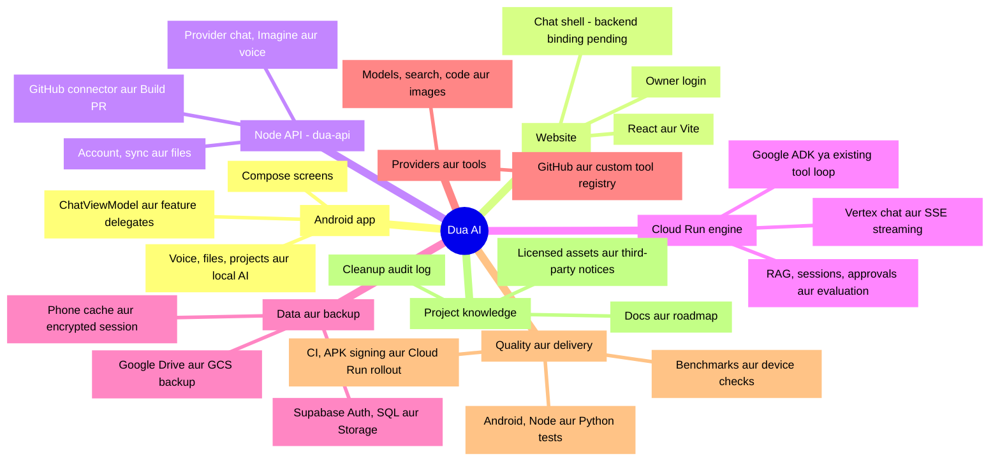
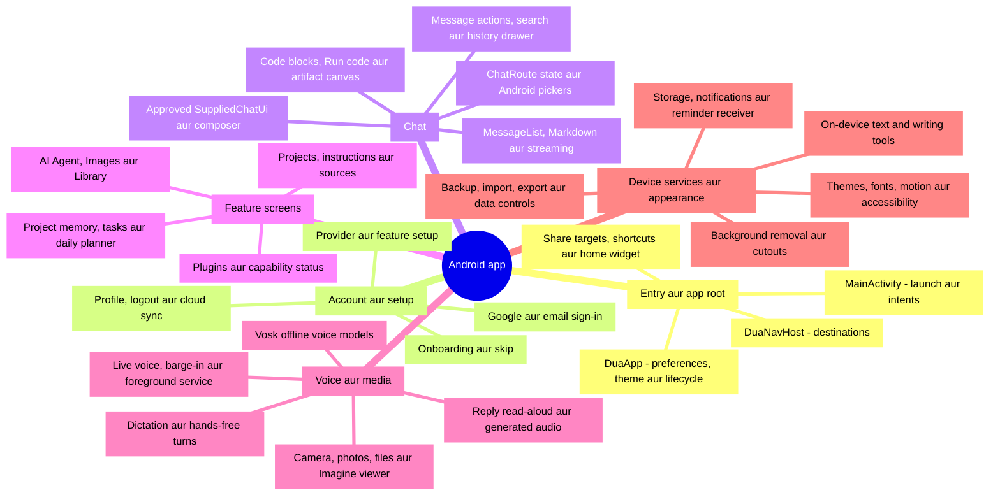
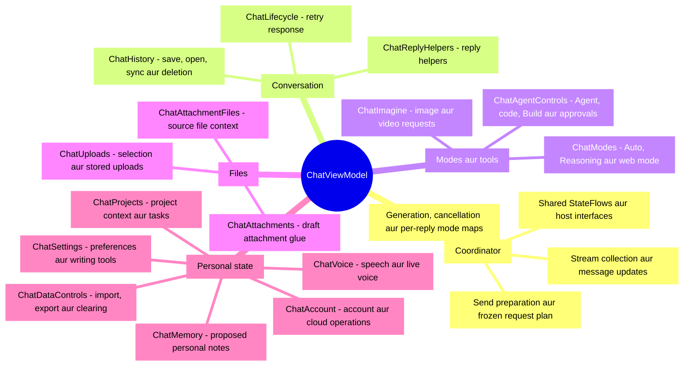
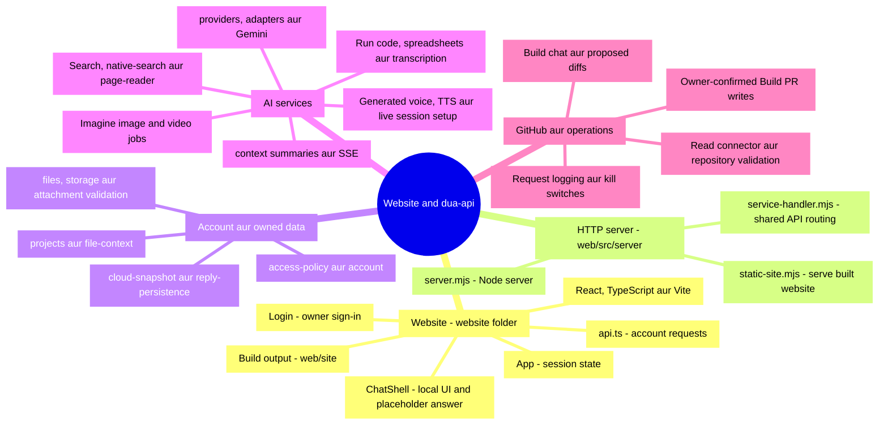
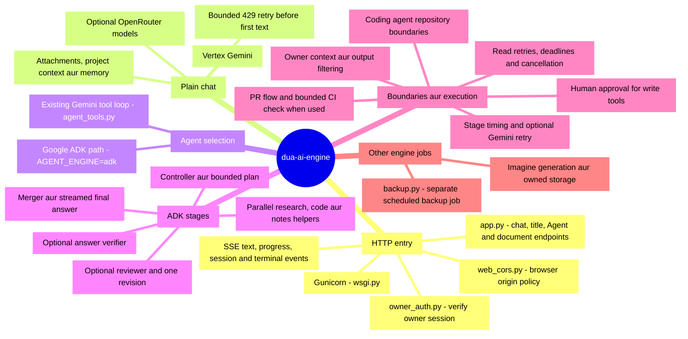
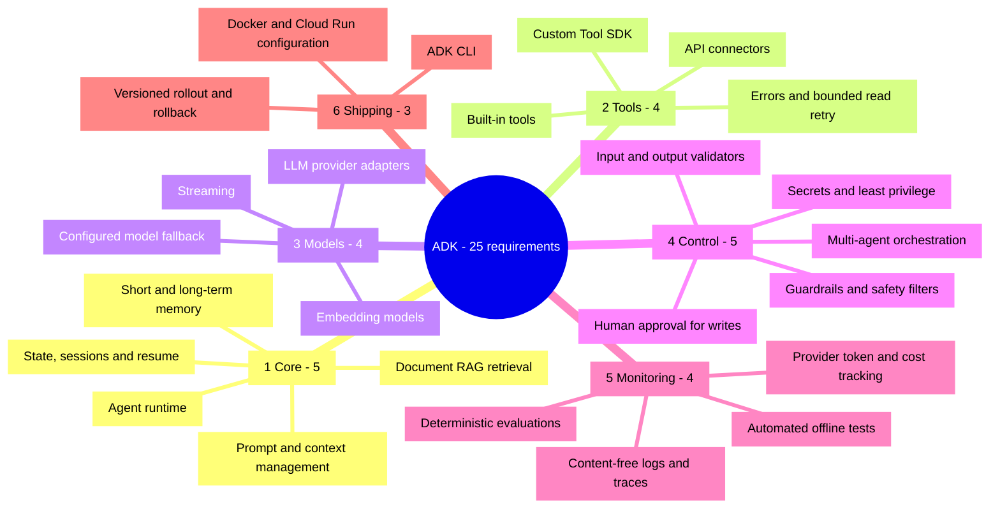
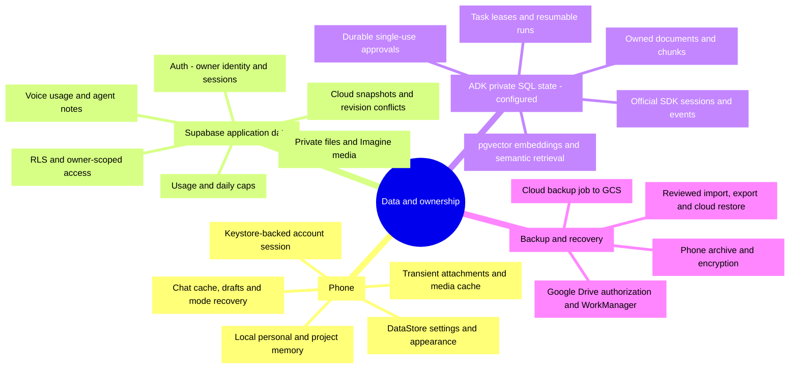
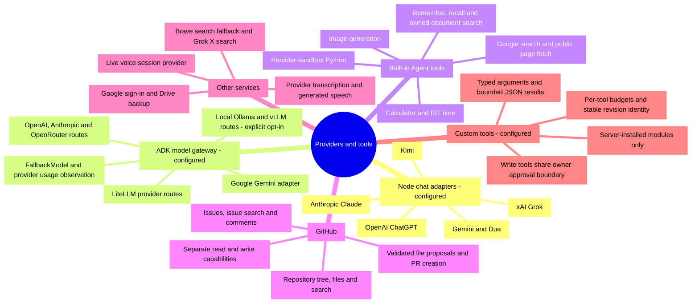
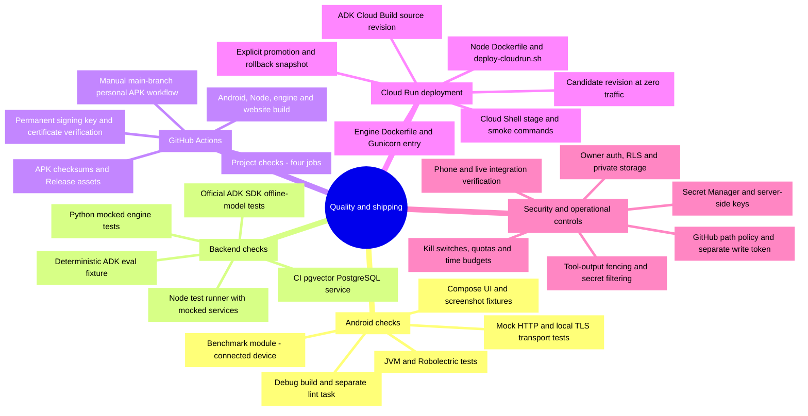
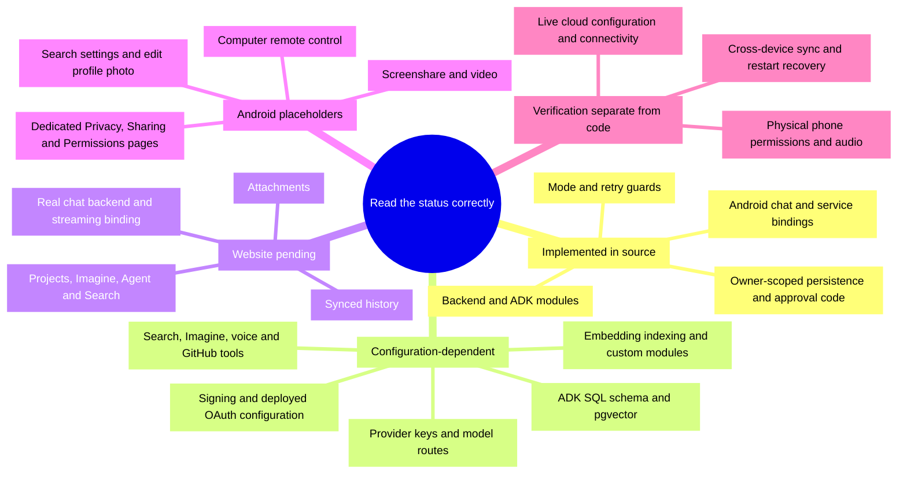

# Dua AI - complete project mind map

Poora project ek jagah: Android app, website, Node API, Cloud Run engine/ADK, data, integrations, tests aur deployment.

**Source snapshot:** [`main@59feb08`](https://github.com/KRFbrothers/Dua-ai/tree/59feb089a6aede3c45eb5be8592c72ce0df9e28d), checked 21 October 2026. Yeh checked-in code ka map hai. **Configured/optional** nodes ko live service availability mat samjho; **pending** nodes source mein placeholder hain.

GitHub par is file ka **Preview** view kholo: neeche Mermaid blocks diagrams ke roop mein dikhte hain. Pehla map overview hai; detailed map ke liye in links se jump karo.

- [1. Poore project ka overview](#overview)
- [2. Android app - screens aur device features](#android)
- [3. ChatViewModel - kaam kis module ka hai](#viewmodel)
- [4. Website aur Node API](#web-api)
- [5. Cloud Run engine aur Agent execution](#engine)
- [6. ADK - tumhare 6 categories aur 25 requirements](#adk-25)
- [7. Data, memory, files aur backup](#data)
- [8. Models, integrations aur tools](#integrations)
- [9. Tests, security aur deployment](#delivery)
- [10. Pending aur configuration-dependent parts](#pending)
- [11. Har top-level folder ka index](#folders)
- [12. ADK requirement se source-file tak](#adk-sources)

## 1. Poore project ka overview

**Code aur guide:** [Runtime connections](ARCHITECTURE.md#runtime-map) · [Project documentation](README.md)

## 2. Android app - screens aur device features

**Code aur guide:** [App entry](../app/src/main/java/com/dua/ai/MainActivity.kt) · [UI packages](../app/src/main/java/com/dua/ai/ui) · [Device AI](../app/src/main/java/com/dua/ai/ondevice) · [Voice implementation](../app/src/main/java/com/dua/ai/voice) · [Entry points](ANDROID_ENTRY_POINTS.md)

## 3. ChatViewModel - kaam kis module ka hai

**Code aur guide:** [All ViewModel modules](../app/src/main/java/com/dua/ai/viewmodel) · [ChatRoute binding](../app/src/main/java/com/dua/ai/ui/chat/ChatRoute.kt) · [Cleanup and split history](../_to_delete/README.md)

## 4. Website aur Node API

**Code aur guide:** [Website components](../website/src) · [Website guide](WEBSITE.md) · [Node server](../web/src/server) · [Node service modules](../web/src/core) · [Node tests](../web/test)

## 5. Cloud Run engine aur Agent execution

**Code aur guide:** [Engine entry](../google-cloud-backend/app.py) · [ADK orchestration](../google-cloud-backend/agent_adk.py) · [Tools loop](../google-cloud-backend/agent_tools.py) · [Coding and PR flow](../google-cloud-backend/coding_agent.py) · [Agent operating guide](AGENT.md)

## 6. ADK - tumhare 6 categories aur 25 requirements

**Code aur guide:** [Exact scope](ADK_SCOPE.md) · [Implementation and configuration](ADK_IMPLEMENTATION.md)

## 7. Data, memory, files aur backup

**Code aur guide:** [Local data and account code](../app/src/main/java/com/dua/ai/account) · [History cache](../app/src/main/java/com/dua/ai/history) · [SQL and Storage migrations](../supabase/migrations) · [ADK session store](../google-cloud-backend/agent_store.py) · [Documents and vector memory](../google-cloud-backend/agent_documents.py) · [Phone backups](STORAGE_BACKUP.md) · [Cloud backup](../google-cloud-backend/backup.py)

## 8. Models, integrations aur tools

**Code aur guide:** [Node provider adapters](../web/src/core/providers.mjs) · [ADK model routing](../google-cloud-backend/agent_models.py) · [Custom tool registry](../google-cloud-backend/agent_toolkit.py) · [Agent tool declarations](../google-cloud-backend/agent_tools.py) · [GitHub boundaries](GITHUB_VALIDATION.md) · [Provider setup](PROVIDERS.md)

## 9. Tests, security aur deployment

**Code aur guide:** [CI workflow](../.github/workflows/checks.yml) · [Signed APK workflow](../.github/workflows/personal-apk.yml) · [APK verifier](../scripts/verify-apk-signature.py) · [Performance module](../benchmark) · [ADK deploy and rollback](../google-cloud-backend/deploy-adk.sh) · [Cloud Shell script](../google-cloud-backend/dua-adk-cloudshell.sh) · [Security policy](../SECURITY.md) · [Operations](OPERATIONS.md) · [Test guide](TESTING.md)

## 10. Pending aur configuration-dependent parts

**Code aur guide:** [Website send handler](../website/src/ChatShell.tsx) · [Android placeholder destinations](../app/src/main/java/com/dua/ai/ui/navigation/DuaDestination.kt) · [Computer screen](../app/src/main/java/com/dua/ai/ui/features/ComputerScreen.kt) · [Release/device checklist](RELEASE_CHECKLIST.md)

## 11. Har top-level folder ka index

Is snapshot ke saare 12 tracked top-level directories, plus root files, neeche covered hain. Build outputs aur secrets is inventory ka hissa nahi hain.

| Folder / root files | Kya hai |
|---|---|
| [`app/`](../app) | Android app, production code, resources, offline Mermaid bundle, JVM/Compose tests, debug previews, baseline profile. |
| [`website/`](../website) | React/Vite website, styles, logo-copy script aur build configuration. Output `web/site` mein jaata hai. |
| [`web/`](../web) | Node API/server, core services, Docker/deploy script, test fixtures, RLS verification aur smoke utilities. |
| [`google-cloud-backend/`](../google-cloud-backend) | Flask/Vertex engine, Google ADK, tool loop, SQL/RAG, CLI, evaluations, container/deployment aur Python tests. |
| [`supabase/`](../supabase) | Application migrations: snapshots, usage, files/Storage, Imagine, voice aur agent notes. ADK private SDK tables `init-db` se initialize hote hain. |
| [`benchmark/`](../benchmark) | Startup macrobenchmark aur Baseline Profile generation; connected device chahiye. |
| [`.github/`](../.github) | Four-job CI aur manual signed personal APK workflow. |
| [`gradle/`](../gradle) | Version catalog aur Gradle wrapper configuration. |
| [`scripts/`](../scripts) | APK signature, certificate aur checksum verification. |
| [`docs/`](.) | Architecture, ADK scope, operations, providers, feature/UI guides, release/testing checklists aur HTML design previews. |
| [`third_party/`](../third_party) | Androidify Apache license text. Root notices aur inline attribution bhi license trail ka part hain. |
| [`_to_delete/`](../_to_delete) | Audit/split history README; folder ka naam automatic deletion permission nahi hai. |
| Root configuration and guides | [`README.md`](../README.md), [`build.gradle.kts`](../build.gradle.kts), [`settings.gradle.kts`](../settings.gradle.kts), [`gradle.properties`](../gradle.properties), wrappers aur Node version files. [`SIGNING.md`](../SIGNING.md), [`SUPABASE.md`](../SUPABASE.md), [`SECURITY.md`](../SECURITY.md), [`LICENSE`](../LICENSE), [`THIRD_PARTY_NOTICES.md`](../THIRD_PARTY_NOTICES.md). |

`dua_gen_ai.py` ek [standalone UI design-generation sample](../dua_gen_ai.py) hai; Android/Node/Flask runtime entry point nahi. Assets, fonts, Telegram/Androidify adaptations aur vendored Mermaid ke notices [THIRD_PARTY_NOTICES.md](../THIRD_PARTY_NOTICES.md) aur [offline Mermaid README](../app/src/main/assets/vendor/mermaid/README.md) mein milte hain.

## 12. ADK requirement se source-file tak

25 requirements ka map section 6 mein hai; yeh table unke implementation tak seedha raasta deta hai.

| Category | Main source locations |
|---|---|
| Core runtime, prompts/context, memory, RAG, sessions | [`agent_adk.py`](../google-cloud-backend/agent_adk.py), [`agent_context.py`](../google-cloud-backend/agent_context.py), [`agent_notes.py`](../google-cloud-backend/agent_notes.py), [`agent_documents.py`](../google-cloud-backend/agent_documents.py), [`agent_store.py`](../google-cloud-backend/agent_store.py) |
| Tools, connectors, custom SDK, retry | [`agent_tools.py`](../google-cloud-backend/agent_tools.py), [`coding_agent.py`](../google-cloud-backend/coding_agent.py), [`agent_toolkit.py`](../google-cloud-backend/agent_toolkit.py), [`agent_resilience.py`](../google-cloud-backend/agent_resilience.py), [`adk_examples/text_tools.py`](../google-cloud-backend/adk_examples/text_tools.py) |
| Provider/embedding models, streaming, fallback | [`agent_models.py`](../google-cloud-backend/agent_models.py), [`agent_documents.py`](../google-cloud-backend/agent_documents.py), [`app.py`](../google-cloud-backend/app.py), [`openrouter.py`](../google-cloud-backend/openrouter.py) |
| Orchestration, guardrails, validation, approvals, secrets | [`agent_adk.py`](../google-cloud-backend/agent_adk.py), [`agent_safety.py`](../google-cloud-backend/agent_safety.py), [`agent_policy.py`](../google-cloud-backend/agent_policy.py), [`owner_auth.py`](../google-cloud-backend/owner_auth.py), [`agent_store.py`](../google-cloud-backend/agent_store.py), [`pr_flow.py`](../google-cloud-backend/pr_flow.py) |
| Traces, token/cost tracking, evaluation, tests | [`agent_observability.py`](../google-cloud-backend/agent_observability.py), [`agent_evaluation.py`](../google-cloud-backend/agent_evaluation.py), [`evals/adk-v1.json`](../google-cloud-backend/evals/adk-v1.json), [`tests/`](../google-cloud-backend/tests) |
| CLI, containers/cloud, versioned rollout/rollback | [`adk_cli.py`](../google-cloud-backend/adk_cli.py), [`adk_server.py`](../google-cloud-backend/adk_server.py), [`Dockerfile`](../google-cloud-backend/Dockerfile), [`cloudbuild-adk.yaml`](../google-cloud-backend/cloudbuild-adk.yaml), [`deploy-adk.sh`](../google-cloud-backend/deploy-adk.sh), [`dua-adk-cloudshell.sh`](../google-cloud-backend/dua-adk-cloudshell.sh) |

Connections/data flow ke liye [Architecture runtime map](ARCHITECTURE.md#runtime-map), configuration ke liye [ADK implementation](ADK_IMPLEMENTATION.md), aur future work ke liye [ROADMAP.md](ROADMAP.md) kholo.
